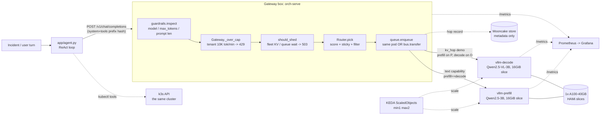
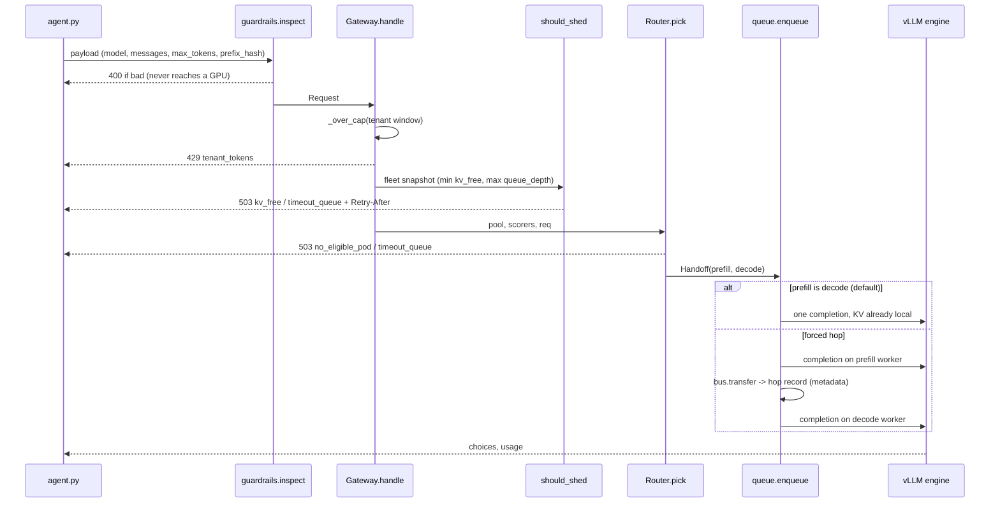

# ARCHITECTURE.md

How the system is built, and why each piece is what it is. `DESIGN.md` answers
the design questions with evidence; `FINDINGS.md` is what I learned; this file
is the structure and the reasoning behind it.

## 1. The two boxes

The gateway and the engine are deliberately *different boxes*: different pods,
different processes, and different owners of different decisions:

| | **Gateway box** (`orch-serve` pod) | **Engine box** (`vllm-prefill`, `vllm-decode` pods) |
|---|---|---|
| Code | `control/gateway/*`, `control/router/*` (Python, stdlib HTTP) | vLLM 0.11 (unmodified) |
| Decides | *whether* a request runs, *where*, *in what order*, whether KV hops | *how* it runs: batching, chunked prefill, block table, prefix cache, preemption |
| State it owns | tenant token windows, per-worker snapshots, hop ledger | KV block pool, waiting/running/swapped queues |
| Fails by | shedding (429/503) before work starts | preempting or refusing to start (OOM at init) |

A rule I held to: **never reimplement the engine's scheduler in the
gateway.** `gateway/queue.py:enqueue()` is a synchronous call, not a queue;
ordering inside a worker is vLLM's continuous batching.

## 2. System view



## 3. One request, step by step



Three separate layers can say no, in this order, and each is cheaper than the
next: **guard** (static, microseconds), **admit** (tenant window + fleet KV /
wait estimate), **place** (a specific worker is ineligible or too slow). The
engine itself is the fourth and last line (preempt / OOM at init).

## 4. Memory layout on the GPU (why the numbers are what they are)

One A100-SXM4-40GB, HAMi-sliced. `--gpu-memory-utilization` is a fraction of
the *slice*, not of the card:

```
slice = 16384 MiB (16 GiB), per engine
|<------------- gpu-memory-utilization x slice ------------->|<-- unused -->|
| weights | activations + overhead |        KV cache         |               |
```

| | prefill / text | decode / vision |
|---|---|---|
| utilization | 0.50 (8 GiB budget) | 0.80 (12.8 GiB budget) |
| weights (measured) | 5.79 GiB | 7.15 GiB |
| KV pool (measured) | 1.68 GiB = 48,800 tok | 2.33 GiB = 67,856 tok |
| concurrency @2048 | 23.83x | 33.13x |

`kv_bytes_per_token = 2 x 36 layers x 2 KV heads x 128 x 2 B = 36,864 B`
(GQA, identical backbone in both models).

**What fills the pool is not the table above.** Those are the *unshared* bounds.
Blocks holding the shared system+tool prefix are stored once and referenced by
every sequence, so at 40 concurrent clients the same pool sat at 4.4% (shared)
vs 99.3% (unique prefix) with identical prompt and output lengths
(`plots/prefix_ab.png`).

## 5. Decision log

Each row is a choice I made, the alternative I rejected, and what would
change my mind. "Evidence" is where it is shown.

| # | Decision | Alternative rejected | Why | Revisit when | Evidence |
|---|---|---|---|---|---|
| D1 | Reuse upstream gateway/router instead of writing a gateway | A new gateway from scratch | upstream's already covers guard/admit/place/queue/hop and passes its own tests, so new code goes only where upstream had a gap (`should_shed`, scorer wiring) | I needed behaviour upstream can't express (e.g. per-class lanes) | `control/tests` 38 pass |
| D2 | Lightweight ReAct loop, no CrewAI/kagent | Keep kagent + OpenAI | A hosted API would not be an engine I can inspect or measure; a framework hides which calls hit the gateway | I needed multi-agent orchestration | DESIGN Part 0 |
| D3 | Ship tools as plain functions + real `kubectl` against the *same* cluster | Fake tool data | The incidents the agent diagnoses are the serving cluster's own; no second system to explain | Agent had to touch untrusted clusters | `app/tools.py` |
| D4 | 1x A100-40GB sliced into 2 | 2 whole GPUs; H100 | I wanted the limits to be reachable on a small budget. (I expected KV to bind first; measured, compute does, FINDINGS F12) | Concurrency demand grows past ~24 | DESIGN Part 2 |
| D5 | Capability split (text / vision), same-worker for text | True same-model prefill/decode split | It is what upstream's manifest deploys; for a text-only agent it means KV never needs to move | Prefill compute becomes the limiter (long RAG prompts) | `hami-lambda.yaml` |
| D6 | `should_shed` as a *pure predicate* over a fleet snapshot, run before placement | Fold shedding into `Router.pick` only | Shedding before choosing a worker is cheaper and separable/testable; `pick` keeps its own per-worker checks as a second line | Per-worker KV skew is large (fleet min is too pessimistic) | `test_should_shed.py` |
| D7 | Stable `prefix_hash` = hash(system + tool schema) | Per-message auto-hash | Every incident shares the same prefix; auto-hash changes each turn so the router could never see affinity | Prompts diverge per tenant | `app/agent.py` |
| D8 | Mooncake store = hop *bookkeeping* | Claim real KV transfer | `VLLMWorker.enqueue` ignores `phase`; the decode engine re-runs the request. The docs say so rather than overclaim | A real KV connector (LMCache/NIXL) is wired | DESIGN Part 6 |
| D9 | Raise decode `--gpu-memory-utilization` 0.50 -> 0.80 | Use a smaller model / bigger slice | Weights + encoder cache left no KV at 0.50; one line fixes it | Slice size changes | DESIGN Part 6 |
| D10 | `score_queue_depth` added to the active scorer lists | Leave as inherited | It was weighted but never scored, so placement ignored the same queue depth that admission uses | -- | DESIGN Part 4 |
| D11 | Gateway never buffers | Add a gateway-side queue | `enqueue()` is already a synchronous call into the worker, and `should_shed`/`Router.pick` read vLLM's own `waiting` depth from the snapshot. A buffer ahead of it would add a wait the engine cannot see and hide the very number admission depends on | I need priority lanes | `queue.py`, `pools.py:snapshot` |
| D12 | Run no hosted overflow | Wire a hosted overflow API | Nothing in this budget needed it; claiming an overflow model I never ran would be an unsupported claim | An SLA required it | DESIGN Part 2 |
| D13 | Mutating cluster tools (`k8s_scale`, `k8s_rollout_restart`) are **off by default** | Leave the agent able to remediate its own serving cluster (my original design, D3) | Under 128 concurrent LLM-driven incidents they changed the deployments being measured. A 3B model improvising remediation is not something to leave on | I add an approval step or a separate target cluster | `app/tools.py`, FINDINGS P7 |
| D14 | An engine 4xx surfaces as that status, never as 200 | Return the engine body and let the client cope | It made engine rejections invisible: counted "completed", empty body, no failure on any dashboard | -- | `EngineRejected`, FINDINGS P6 |

## 6. Failure modes and what catches them

| Failure | Caught by | Observed? |
|---|---|---|
| Malformed payload / oversized prompt | `guardrails.inspect` -> 400 | Unit-tested, not seen live |
| One tenant floods | `_over_cap` -> 429 | Yes, 104 times |
| Fleet KV nearly full / queue too long | `should_shed` / router KV filter -> 503 `kv_free` | **Yes**: 110 sheds when prefix sharing was removed (FINDINGS F14); never under the agent workload |
| No eligible worker | `Router.pick` -> 503 | 2 `no_eligible_pod` in the same test |
| Engine cannot allocate KV at boot | vLLM init `ValueError` | **Yes**: decode crash-looped 5x |
| Replica "Ready" but cold | nothing in the gateway today | **Yes**: 1.19s vs 0.09s |
| Second replica cannot schedule | k8s `FailedScheduling` | **Yes**: hostPort on 1 node |
| Telemetry stale | `is_unknown` -> treated as not-idle | Unit-tested only |
| Engine rejects the request (4xx, e.g. over `max-model-len`) | `EngineRejected` -> the engine's own status, `orch_engine_rejected_total` | **Yes**: it used to come back as a fake 200 (FINDINGS P6) |
| The agent's own tools change the serving cluster | mutating tools off unless `SRE_ALLOW_MUTATIONS=1` | **Yes**: a decode rollout restart and prefill flaps during a sweep (FINDINGS P7) |
| KV fills despite the shed | engine preemption | **Yes**: 26 preemptions behind 110 sheds (the shed reads a lagged value) |

## 7. What is deliberately NOT here

No autoscaling beyond KEDA's (blocked by hostPort on one node), no real KV
transfer, no overflow target, no priority lane, no auth.
