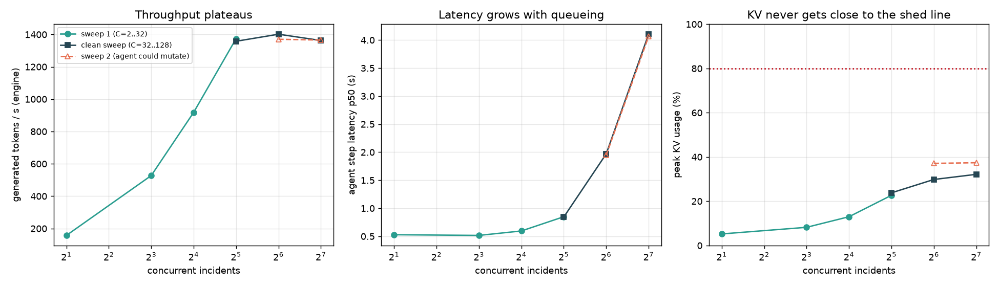
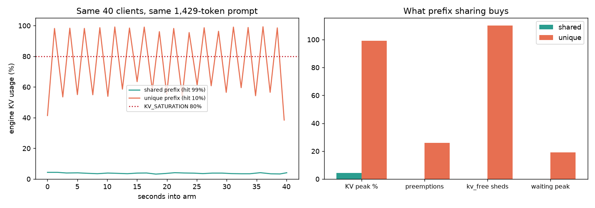

# Triage

**An SRE incident-response agent, and the GPU-aware gateway that decides which of
its requests get served.**

"Triage" is doing double duty: the agent triages Kubernetes incidents (P1-P4),
and the gateway triages requests at the GPU door: what is admitted, where it
runs, what gets shed. Everything runs against a real A100 with real vLLM
engines. Nothing is simulated and no hosted API sits behind it.

```
incident -> agent (think/tool/observe) -> gateway: guard -> admit -> place -> queue -> hop -> vLLM x2 (one A100, HAMi-sliced)
```

The hop step records a KV handoff between workers; it does not copy KV tensors
(see [DESIGN.md](DESIGN.md) Part 6).

## What I found

I expected KV cache to be the limiter. It wasn't, and the repo documents how I
found that out and corrected myself:

| Finding | Evidence |
|---|---|
| **Compute, not KV, limits this workload.** Throughput plateaus at ~1,370 tok/s from 32 concurrent incidents while KV peaks at 32% | `plots/wall.png` |
| **Prefix sharing is what keeps KV low.** Same 40 clients, same prompt length: KV 4.4% with a shared prefix vs 99.3% with unique ones (26 preemptions, 110 sheds) | `plots/prefix_ab.png` |
| **"Ready" is not "warm".** The first request after `/health` returns 200 is 11-16x slower than steady state | `metrics/exp_warmup/` |
| **A gateway bug hid engine rejections as HTTP 200.** Found by noticing the engine's counters were frozen while the gateway reported success | `FINDINGS.md` P6 |
| **The agent restarted the deployment it was being measured on.** Its own remediation tools are now off by default | `FINDINGS.md` P7 |




## Where to start

- **Run it yourself:** [GETTING_STARTED.md](GETTING_STARTED.md), a from-zero
  walkthrough (about 10 minutes of script time on a fresh GPU instance).
- **What I learned, and how sure I am:** [FINDINGS.md](FINDINGS.md). Every
  finding names its evidence; hypotheses are checked against results; bugs in my
  own work are listed.
- **How it's built and why:** [ARCHITECTURE.md](ARCHITECTURE.md): diagrams,
  GPU memory layout, a decision log with the alternatives I rejected.
- **The design questions, answered with data:** [DESIGN.md](DESIGN.md).

```
app/         the SRE agent (ReAct loop), its tools, the load generator, experiments
control/     the gateway + router: guard / admit (should_shed) / place / queue / hop
cluster/     k3s + HAMi GPU slicing + Mooncake + KEDA + Grafana, and the scripts that bring it up
plots/       figures generated from real traffic
metrics/     raw scrapes and every logged agent turn / experiment sample
notebook/    executed notebook: queue, KV and warm-up questions answered from live scrapes
```

## Background and credits

This started as the final project for *AI Inference Engineering & Systems
Design* (Maven, taught by Abi Aryan): serve an agent on a real GPU, own the
admission, placement and queueing decisions, and prove them with live metrics.

It builds on two open projects, and the credit is theirs:

- **[goabiaryan/class-code](https://github.com/goabiaryan/class-code)** is the
  course's lab repo. The gateway/router, the Kubernetes/HAMi/KEDA/Mooncake
  manifests, and the bring-up scripts began there (called "upstream"
  in these docs).
- **[chaitanya14/k8s-incident-response-agent](https://github.com/chaitanya14/k8s-incident-response-agent)**
  (Apache-2.0) is the SRE agent whose methodology, four reasoning tools and
  runbook knowledge base were ported here to run on a self-hosted engine.

In short: `control/` and `cluster/` start from the lab code above, with
changes for admission shedding, engine-error handling, queue-depth scoring, the
decode memory fix and the bring-up scripts. `app/` (the agent loop, cluster
tools, load generator and experiments) and all measurements, plots and
write-ups are new; only `app/guardrails.py` is unchanged from upstream. Four of
the agent's tools and `app/data/runbooks.json` come from the second project and
are marked as modified in `app/tools.py`.

## License

Apache-2.0, see [LICENSE](LICENSE).

## Quick reference (assumes the cluster is already up — see GETTING_STARTED.md)

Once the gateway is reachable at `127.0.0.1:8080` (tunneled from the GPU box):

```bash
python -m venv .venv && source .venv/bin/activate
pip install -r control/requirements.txt -r app/requirements.txt
export PYTHONPATH="$PWD:$PWD/control"
export KUBECONFIG=~/.kube/config-lambda   # or wherever your kubeconfig is

python -m app.agent --incident "Check vllm-decode's status and recent events." --max-steps 4
python -m app.load_gen --incidents 6 --workers 4 --max-steps 3 --duration-s 120 --force-hop
python -m app.experiments wall --levels 32,64,128 --duration 45
python -m app.experiments prefix --concurrency 40 --duration 40
python -m app.make_plots
```

Tests: `cd control/tests && python -m pytest -q` (32 inherited control-plane
tests + 5 for `should_shed` + 1 regression test for engine rejections, 38 in all).
